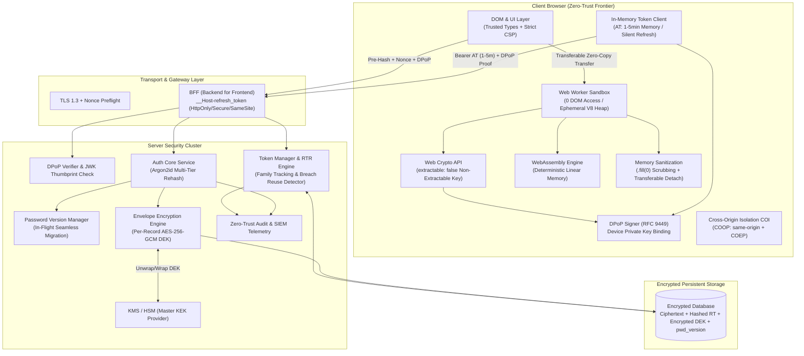

# WebApp Trust 🛡️
### Zero-Trust Full-Stack Authentication & Frontend Defense Skill for AI Agents

English | [简体中文](./readme-zh-hans.md) | [正體中文](./readme-zh-hant.md)

[](#-core-security-architecture)
[-green.svg)](./references/dpop-and-device-binding.md)
[](./references/passwordless-webauthn-totp.md)
[](./examples/)

`webapp-trust` is an enterprise-grade agent skill and developer runbook engineered for building **Zero-Trust authentication architectures and deep client-side defenses** in modern web applications. It bridges modern cryptography, browser isolation sandboxes, and web security standards to provide end-to-end defense across browser runtimes, network transport, and persistent database storage.

---

## 🌟 Core Principles & Security Pillars

```
┌─────────────────────────────────────────────────────────────────────────────┐
│                           Three Zero-Trust Tenets                           │
│  1. Verify Explicitly            2. Use Least Privilege Access             │
│  3. Assume Breach (Assume network is tapped, client is probed, DB is dumped)│
└─────────────────────────────────────────────────────────────────────────────┘
```

- 🔄 **Single-Use Cryptographic Nonce Anti-Replay**: High-security authentication transactions (login, credential change, token rotation) require pre-negotiated server nonces, atomically consumed (`GETDEL` semantics) and continuously rotated to prevent replay attacks.
- ⏳ **Ultra-Short Dual-Token Model & Refresh Token Rotation (RTR)**:
  - **Access Token (AT)**: Lifetime of **1 to 5 minutes**, held strictly in **application memory variables** (JS closure / Web Worker memory). **Instantly destroyed upon tab/page close, 0 persistence on disk**.
  - **Refresh Token (RT)**: Lifetime of **1 to 3 days**, stored exclusively in cookies with `HttpOnly; Secure; SameSite=Strict/Lax` flags, **completely eliminating JavaScript access and XSS exfiltration**.
  - **Breach Detection & Cascading Invalidation**: Presenting a previously used RT triggers immediate revocation of the **entire Token Family**, instantly terminating all sessions for that device.
- 🔑 **Web Crypto Non-Extractable Keys & DPoP Device Binding (RFC 9449)**:
  - Browser private keys are generated with `extractable: false` via `SubtleCrypto.generateKey()`; raw private key bytes reside strictly within the browser's native C++/Rust security sandbox.
  - Coupled with RFC 9449 DPoP, every request is signed by the browser's non-extractable private key. **Even if session credentials leak, an attacker cannot forge requests without the physical device's private key**.
- 🧱 **Multi-Tier Password Hashing & In-Flight Version Migration**:
  - Client performs early pre-hashing (HMAC-SHA256) to eliminate plaintext passwords from network transit and internal logs; server applies multi-tier salted Argon2id / PBKDF2 hashing.
  - Manages `pwd_version` password schemas, automatically and seamlessly upgrading legacy hashes to the target algorithm upon successful user login.
- 📦 **Database KMS Envelope Encryption (DEK / KEK)**:
  - Password verifiers, TOTP seeds, and WebAuthn credentials are encrypted with unique per-record 256-bit AES-GCM Data Encryption Keys (DEKs). DEKs are wrapped using Master Key Encryption Keys (KEKs) managed in Cloud KMS / HSM.
- 🧼 **WebAssembly Linear Memory & Explicit Memory Scrubbing**:
  - Sensitive cryptographic routines execute in Wasm deterministic linear memory, avoiding JavaScript Garbage Collector (GC) heap retention. Ephemeral `Uint8Array` buffers in JS are explicitly zeroed with `.fill(0)` and immediately dereferenced.
- 🛡️ **Browser Platform Hardening**:
  - Enables Cross-Origin Isolation (`COOP: same-origin` + `COEP: require-corp`) to defeat Spectre-style microarchitectural side-channel attacks.
  - Enforces strict CSP and `Trusted Types` (`require-trusted-types-for 'script'`) to eradicate DOM XSS sink vulnerabilities.
- 🚀 **Passwordless Ecosystem**: First-class support for FIDO2 / WebAuthn Passkeys (Level 3) and replay-suppressed TOTP (RFC 6238).

---

## 🏛️ Core Security Architecture



---

## 📁 Directory Structure & Documentation Index

```text
.agents/skills/webapp-trust/
├── README.md                                 # English Overview & Runbook (This File)
├── readme-zh-hans.md                         # Simplified Chinese Runbook (简体中文)
├── readme-zh-hant.md                         # Traditional Chinese Runbook (正體中文)
├── SKILL.md                                  # Agent Main Manual (Loaded by Antigravity)
│
├── references/                               # Technical Specifications & Security Guides
│   ├── zero-trust-auth-flow.md               # 1. Nonce Handshake, Multi-Tier Hashing & Password Migration
│   ├── tokens-and-rotation-lifecycle.md      # 2. Dual-Token (AT 1-5m + RT 1-3d), RTR Rotation & Breach Revocation
│   ├── client-defense-and-webcrypto.md       # 3. Non-Extractable Keys, Wasm Linear Memory, Scrubbing & COI
│   ├── dpop-and-device-binding.md            # 4. DPoP (RFC 9449) Device Binding & Web Crypto Signing
│   ├── envelope-encryption-and-storage.md    # 5. KMS Envelope Encryption (DEK/KEK) & Database Schemas
│   ├── passwordless-webauthn-totp.md         # 6. Passkeys / WebAuthn Ceremonies & Replay-Resistant TOTP
│   ├── bff-and-session-architecture.md       # 7. BFF Architecture & __Host- HttpOnly Cookie Sessions
│   └── audit-logging-and-threat-detection.md # 8. Zero-Trust Structured Audit Events & Threat Telemetry
│
└── examples/                                 # Production-Grade TypeScript Implementations
    ├── client/
    │   ├── crypto-sandbox.ts                 # Non-extractable key generation, HMAC pre-hash & memory zeroing
    │   ├── auth.worker.ts                    # Dedicated Web Worker cryptographic sandbox
    │   ├── worker-bridge.ts                  # Transferable memory zero-copy transfer & worker lifecycle
    │   ├── token-client.ts                   # In-memory AT manager, proactive silent refresh & DPoP fetch
    │   ├── dpop-signer.ts                    # Client RFC 9449 DPoP Proof generator
    │   └── webauthn-helper.ts                # Passkeys registration and authentication helper
    ├── server/
    │   ├── nonce-handshake.ts                # Server nonce issue, HMAC verification & atomic rotation
    │   ├── token-manager.ts                  # Dual-token issuance, RTR rotation, family tree & reuse detection
    │   ├── envelope-encryption.ts            # DEK/KEK envelope encryption engine & multi-version password manager
    │   └── dpop-verifier.ts                  # Server DPoP proof verifier & JWK thumbprint validator
    └── verification-suite.ts                 # End-to-end integration and verification test suite
```

---

## ⚡ Quick Start & Usage Examples

### 1. Client: In-Memory AT with DPoP Authenticated Fetch
```typescript
import { ZeroTrustTokenClient } from "./examples/client/token-client";
import { generateNonExtractableSigningKey } from "./examples/client/crypto-sandbox";

// 1. Generate or load browser non-extractable key pair (extractable: false)
const keyPair = await generateNonExtractableSigningKey();

// 2. Initialize Zero-Trust Token Client
const authClient = new ZeroTrustTokenClient({
  bffBaseUrl: "https://api.yourdomain.com",
  keyPair,
  onAuthFailure: (err) => console.error("Session expired or revoked:", err),
});

// 3. Perform authenticated API request (Handles in-memory AT, silent refresh, and DPoP device signing)
const response = await authClient.authenticatedFetch("/api/user/profile", {
  method: "GET",
});
const data = await response.json();
```

### 2. Server: Handling Refresh Token Rotation & Breach Detection
```typescript
import { TokenManagerService } from "./examples/server/token-manager";

// Executed when client requests POST /auth/token/refresh
try {
  const newTokens = await tokenManager.rotateRefreshToken(
    rawRefreshTokenFromCookie,
    "read:profile write:data",
    presentedDpopJkt
  );

  // Set rotated RT Cookie (1-3 days rolling)
  res.setHeader("Set-Cookie", `__Host-refresh_token=${newTokens.rawRefreshToken}; Path=/auth/token/refresh; Secure; HttpOnly; SameSite=Strict; Max-Age=259200; Partitioned`);
  
  // Return short-lived in-memory Access Token (1-5 minutes)
  res.json({ accessToken: newTokens.accessToken, expiresIn: newTokens.expiresInSeconds });
} catch (error) {
  if (error.message.includes("BREACH_DETECTED")) {
    // Replay attack caught: entire token family revoked automatically, force client logout
    res.status(401).json({ error: "TOKEN_COMPROMISED_FORCE_LOGOUT" });
  }
}
```

---

## 🧪 Running the Verification Test Suite

The skill includes an automated end-to-end integration simulation suite [`verification-suite.ts`](file:///c:/Users/hokdu/.agents/skills/webapp-trust/examples/verification-suite.ts) verifying all 12 key cryptographic and authentication phases:

1. **Step 1-2**: Server issues pre-negotiated Nonce $\to$ Client computes HMAC pre-hash and zeroes raw password memory with `.fill(0)`.
2. **Step 3-4**: Database loads `v1` legacy credential record $\to$ Server atomically validates Nonce and issues next rotated Nonce.
3. **Step 5**: **Anti-Replay Verification**: Attempts to replay the consumed Nonce; server strictly detects and rejects the attempt.
4. **Step 6-7**: **In-Flight Version Migration**: Upon successful legacy authentication, server automatically rehashes with Argon2id and updates the DB record to `v2` via KMS Envelope Encryption.
5. **Step 8-10**: **Dual-Token & RTR**: Issues 180s AT + 3d RT, performing legitimate token rotation ($G_0 \to G_1$).
6. **Step 11-12**: **Breach & Reuse Detection**: Simulates replaying stale $G_0$ token; server triggers **Cascading Family Revocation**, proving $G_1$ is instantly invalidated.

---

## 📜 Standards & Compliance References

- **Zero Trust Architecture**: [NIST SP 800-207 Zero Trust Architecture](https://csrc.nist.gov/publications/detail/sp/800-207/final)
- **Proof of Possession**: [RFC 9449 OAuth 2.0 Demonstrating Proof of Possession (DPoP)](https://datatracker.ietf.org/doc/html/rfc9449)
- **Time-Based One-Time Passwords**: [RFC 6238 TOTP Algorithm](https://datatracker.ietf.org/doc/html/rfc6238)
- **Web Authentication**: [W3C Web Authentication (WebAuthn) Level 3](https://www.w3.org/TR/webauthn-3/)
- **Application Security Standard**: [OWASP ASVS v4.0.3 (Authentication & Session Management)](https://owasp.org/www-project-application-security-verification-standard/)
