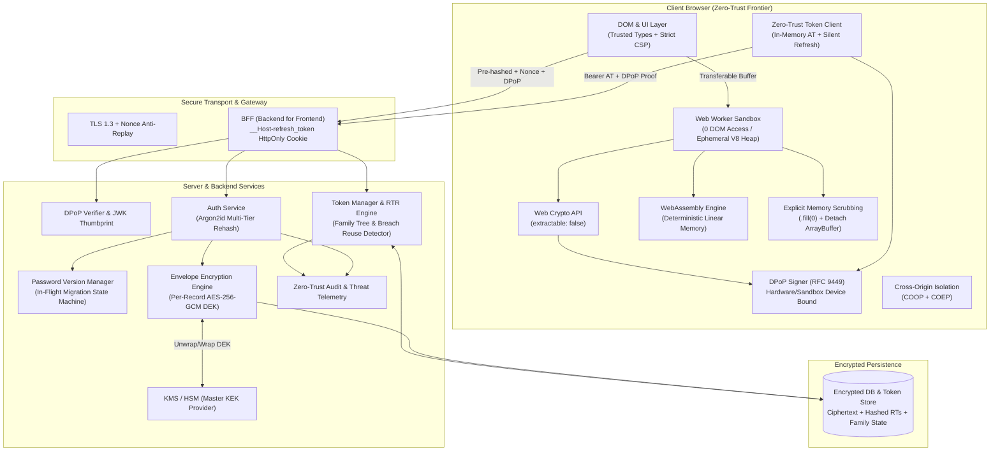

# WebApp Trust: Zero-Trust Web Application Authentication Skill

This skill provides comprehensive architectural patterns, security standards, and production-ready implementations for building resilient, zero-trust web application authentication systems.

---

## Core Security Architecture

---

## 1. Architectural Checklist & Standards

| Security Domain | Mandatory Controls | Reference Guide |
| :--- | :--- | :--- |
| **Anti-Replay Nonce** | Pre-negotiated server nonce for high-security actions; atomic single-use consumption (`GETDEL`), continuous chain rotation. | [Nonce Anti-Replay](./references/zero-trust-auth-flow.md) |
| **Token Dual-Model** | Ultra short-lived Access Token (1-5m in-memory variable, destroyed on page close) + Rolling Refresh Token (1-3d, `__Host-` `HttpOnly`, `Secure`, `SameSite=Strict/Lax` cookie) with RTR & breach invalidation. | [Token Lifecycle & Rotation](./references/tokens-and-rotation-lifecycle.md) |
| **Password Pipeline** | Client pre-hashing (HMAC-SHA256) + Server multi-tier re-hashing (Argon2id) + `pwd_version` in-flight migration. | [Password Pipeline & Versioning](./references/zero-trust-auth-flow.md) |
| **Database Encryption** | Envelope encryption (KEK in KMS/HSM, per-record AES-256-GCM DEK) for TOTP seeds, password verifiers, and credentials. | [Envelope Encryption](./references/envelope-encryption-and-storage.md) |
| **Passwordless Auth** | WebAuthn / Passkeys (FIDO2 Level 3) + Replay-resistant encrypted TOTP (RFC 6238). | [Passwordless & 2FA](./references/passwordless-webauthn-totp.md) |
| **Key Isolation** | Browser Web Crypto API with `extractable: false` (Non-extractable CryptoKey handles). | [Client Defense & Web Crypto](./references/client-defense-and-webcrypto.md) |
| **Device Binding** | DPoP (RFC 9449) device-bound session proofs signed with non-extractable client keys. | [DPoP & Device Binding](./references/dpop-and-device-binding.md) |
| **Worker Sandboxing** | Isolated Web Worker cryptographic thread with zero-copy transferable ArrayBuffers. | [Client Defense & Web Crypto](./references/client-defense-and-webcrypto.md) |
| **Memory Sanitization** | Wasm deterministic linear memory + JavaScript explicit zeroing (`Uint8Array.fill(0)` and nulling). | [Client Defense & Web Crypto](./references/client-defense-and-webcrypto.md) |
| **Runtime Hardening** | Cross-Origin Isolation (`COOP: same-origin`, `COEP: require-corp`) + Strict CSP (`require-trusted-types-for 'script'`). | [Client Defense & Web Crypto](./references/client-defense-and-webcrypto.md) |
| **Token Invisibility** | BFF architecture sinking session state into `__Host-` `HttpOnly`, `Secure`, `SameSite=Strict` cookies. | [BFF & Session Architecture](./references/bff-and-session-architecture.md) |
| **Security Telemetry** | Structured OpenTelemetry audit events for replay spikes, token reuse breach, and key mismatches. | [Audit Logging & Threats](./references/audit-logging-and-threat-detection.md) |

---

## 2. Directory Navigation

### Technical References
- [Detailed Auth Flow & Nonce Protocol](./references/zero-trust-auth-flow.md)
- [Access Token & Refresh Token Rotation (RTR) Lifecycle](./references/tokens-and-rotation-lifecycle.md)
- [Client Memory Defense, Wasm & Web Crypto](./references/client-defense-and-webcrypto.md)
- [DPoP (RFC 9449) Device Binding & Non-Extractable Keys](./references/dpop-and-device-binding.md)
- [Envelope Encryption & KMS Schemas](./references/envelope-encryption-and-storage.md)
- [Passwordless WebAuthn & TOTP](./references/passwordless-webauthn-totp.md)
- [BFF & HttpOnly Session Management](./references/bff-and-session-architecture.md)
- [Zero-Trust Audit Logging & Threat Detection](./references/audit-logging-and-threat-detection.md)

### Reference Implementations (TypeScript)
- [Client Cryptographic Sandbox](./examples/client/crypto-sandbox.ts)
- [Client Web Worker Sandbox & Thread Isolation](./examples/client/auth.worker.ts)
- [Client Worker Bridge & Memory Zero-Copy Transfer](./examples/client/worker-bridge.ts)
- [Client Zero-Trust Token Manager (In-Memory AT & Silent Refresh)](./examples/client/token-client.ts)
- [Client DPoP Proof Signer](./examples/client/dpop-signer.ts)
- [Client WebAuthn Ceremony Handler](./examples/client/webauthn-helper.ts)
- [Server Nonce Handshake & Anti-Replay Manager](./examples/server/nonce-handshake.ts)
- [Server Token Manager & RTR Engine (Family Tree / Reuse Detection)](./examples/server/token-manager.ts)
- [Server Envelope Encryption & Password Version Manager](./examples/server/envelope-encryption.ts)
- [Server DPoP Proof Verifier](./examples/server/dpop-verifier.ts)
- [End-to-End Integration Verification Suite](./examples/verification-suite.ts)
