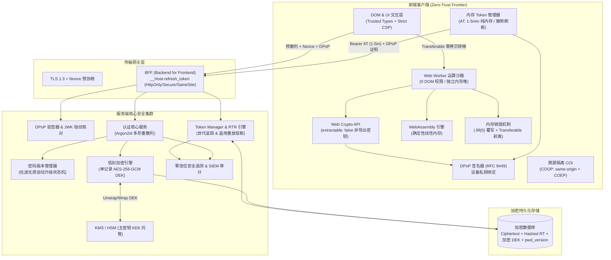

# WebApp Trust 🛡️
### 现代化 Web 应用零信任（Zero-Trust）全栈认证安全智能体技能库

[English](./README.md) | 简体中文 | [正體中文](./readme-zh-hant.md)

[](#-核心安全架构图)
[-green.svg)](./references/dpop-and-device-binding.md)
[](./references/passwordless-webauthn-totp.md)
[](./examples/)

`webapp-trust` 是专为 AI 编程智能体及全栈开发者打造的**通用零信任认证与前端纵深防御技能包**。它融合了现代密码学、底层沙箱隔离与浏览器安全前沿标准，为 Web 应用程序提供从浏览器运行态、传输链路到后端持久化存储的全链路无死角防御。

---

## 📦 安装指南

使用以下命令一键将该技能安装到你的 AI 智能体环境中：

```bash
npx skills add koo14/webapp-trust
```

---

## 🌟 核心设计理念与安全特性

```
┌─────────────────────────────────────────────────────────────────────────────┐
│                            零信任三大核心准则                               │
│  1. 持续验证 (Verify Explicitly)   2. 最小特权 (Least Privilege Access)     │
│  3. 假定失陷 (Assume Breach: 假定网络可被抓包、浏览器可被渗透、数据库可被盗) │
└─────────────────────────────────────────────────────────────────────────────┘
```

- 🔄 **单次密码学 Nonce 防重放**：高安全认证请求（登录、修改凭证、令牌刷新等）强制服务端预协商签发 Nonce，使用后原子核销（`GETDEL` 语义）并链式轮换，从源头阻断重放攻击。
- ⏳ **超短效双 Token 与滚动轮换 (RTR)**：
  - **Access Token (AT)**：有效期仅 **1 ~ 5 分钟**，仅保存在应用**内存变量**（JS 闭包 / Web Worker）中，**页面关闭即刻销毁，0 磁盘落盘**。
  - **Refresh Token (RT)**：有效期 **1 ~ 3 天**，存储在带有 `HttpOnly; Secure; SameSite=Strict/Lax` 属性的 Cookie 中，**彻底杜绝 JS 脚本访问与 XSS 窃取**。
  - **重放熔断 (Breach Detection)**：检测到旧 RT 再次提交时，立即触发**家族级联吊销（Cascading Revocation）**，瞬间作废该设备全量会话。
- 🔑 **Web Crypto “非导出密钥”与 DPoP 设备绑定 (RFC 9449)**：
  - 浏览器通过 `SubtleCrypto.generateKey()` 将 `extractable` 设为 `false`；私钥原始字节隔离在浏览器底层 C++/Rust 原生安全沙箱中，JS 仅持有不透明句柄。
  - 结合 RFC 9449 DPoP，每次高安全请求由非导出私钥实时签名，**即使会话凭证泄露，攻击者缺少物理设备底层私钥依然无法伪造请求**。
- 🧱 **密码多阶散列与在途无感版本迁移**：
  - 客户端提早计算预散列（HMAC-SHA256），避免明文密码在传输与内网流转；服务端接入 Argon2id / PBKDF2 多阶加盐散列。
  - 引入 `pwd_version` 密码版本控制，老版本用户登录成功时在服务端**自动无感升级至最新安全模型并重加密**。
- 📦 **数据库 KMS 信封加密 (Envelope Encryption)**：
  - 密码散列、TOTP 密钥、WebAuthn 凭证均使用独立的 256 位 AES-GCM 数据加密密钥（DEK）加密；DEK 由 KMS/HSM 主密钥（KEK）封装，防止数据库拖库泄密。
- 🧼 **WebAssembly 线性内存与显式零化擦除**：
  - 敏感数据运算迁移至 Wasm 确定性线性内存，绕过 JS 垃圾回收（GC）残留；敏感 `Uint8Array` 用毕立即执行 `.fill(0)` 覆写并断开引用。
- 🛡️ **浏览器原生纵深防御**：
  - 开启跨源隔离（`COOP: same-origin` + `COEP: require-corp`）阻断 Spectre 类侧信道攻击；
  - 强制 CSP 与 `Trusted Types`，从根源消除 DOM XSS 汇聚点。
- 🚀 **无密码认证生态**：原生支持 FIDO2 / WebAuthn Passkeys 及防时间步重放的 TOTP（RFC 6238）。

---

## 🏛️ 核心安全架构图



---

## 📁 目录结构与模块索引

```text
.agents/skills/webapp-trust/
├── README.md                                 # 英文全景文档 (English)
├── readme-zh-hans.md                         # 简体中文全景文档（本文件）
├── readme-zh-hant.md                         # 正體中文全景文档
├── SKILL.md                                  # 智能体主指令手册（供 Antigravity 调阅）
│
├── references/                               # 深度技术规格与安全白皮书
│   ├── zero-trust-auth-flow.md               # 1. Nonce 协商防重放、多阶加盐散列与密码版本迁移机制
│   ├── tokens-and-rotation-lifecycle.md      # 2. 双 Token (AT 1-5m + RT 1-3d) 生命周期、RTR 轮换与熔断
│   ├── client-defense-and-webcrypto.md       # 3. 非导出密钥、Wasm 线性内存、内存擦除、CSP/Trusted Types 及 COI
│   ├── dpop-and-device-binding.md            # 4. DPoP (RFC 9449) 设备绑定与 Web Crypto 签名机制
│   ├── envelope-encryption-and-storage.md    # 5. KMS 信封加密 (DEK/KEK) 与数据库密文表结构设计
│   ├── passwordless-webauthn-totp.md         # 6. Passkeys / WebAuthn 仪式与防重放 TOTP 规格
│   ├── bff-and-session-architecture.md       # 7. BFF 架构下沉与 __Host- HttpOnly Cookie 会话管理
│   └── audit-logging-and-threat-detection.md # 8. 零信任结构化审计事件与 SIEM 威胁感知指标
│
└── examples/                                 # 生产级强类型参考实现 (TypeScript)
    ├── client/
    │   ├── crypto-sandbox.ts                 # 客户端非导出密钥生成、HMAC 预散列与内存零化
    │   ├── auth.worker.ts                    # 独立 Web Worker 运算沙箱
    │   ├── worker-bridge.ts                  # Transferable 内存零拷贝转移与 Worker 瞬时销毁
    │   ├── token-client.ts                   # 纯内存 AT 管理、主动静默刷新与 DPoP 鉴权 Fetch 封装
    │   ├── dpop-signer.ts                    # 客户端 RFC 9449 DPoP Proof 签名器
    │   └── webauthn-helper.ts                # Passkeys 注册与登录仪式封装
    ├── server/
    │   ├── nonce-handshake.ts                # 服务端 Nonce 签发、HMAC 签名校验与原子核销轮换
    │   ├── token-manager.ts                  # 双 Token 签发、RTR 滚动轮换、世代比对与盗用熔断引擎
    │   ├── envelope-encryption.ts            # DEK/KEK 信封加解密引擎与多版本密码自动升级逻辑
    │   └── dpop-verifier.ts                  # 服务端 DPoP Proof 验签与 JWK 指纹核对
    └── verification-suite.ts                 # 端到端全链路集成验证与测试套件
```

---

## ⚡ 快速上手与集成示例

### 1. 客户端：纯内存 AT 发送 DPoP 鉴权请求
```typescript
import { ZeroTrustTokenClient } from "./examples/client/token-client";
import { generateNonExtractableSigningKey } from "./examples/client/crypto-sandbox";

// 1. 生成或加载浏览器非导出密钥对 (extractable: false)
const keyPair = await generateNonExtractableSigningKey();

// 2. 初始化零信任 Token 客户端
const authClient = new ZeroTrustTokenClient({
  bffBaseUrl: "https://api.yourdomain.com",
  keyPair,
  onAuthFailure: (err) => console.error("Session expired or revoked:", err),
});

// 3. 发送业务请求（自动处理内存 AT、静默 Nonce 预检与 DPoP 设备私钥签名）
const response = await authClient.authenticatedFetch("/api/user/profile", {
  method: "GET",
});
const data = await response.json();
```

### 2. 服务端：处理 Refresh Token 轮换与盗用重放防御
```typescript
import { TokenManagerService } from "./examples/server/token-manager";

// 当客户端访问 /auth/token/refresh 时触发
try {
  const newTokens = await tokenManager.rotateRefreshToken(
    rawRefreshTokenFromCookie,
    "read:profile write:data",
    presentedDpopJkt
  );

  // 设置新一轮生成的 RT Cookie（1-3天滚动）
  res.setHeader("Set-Cookie", `__Host-refresh_token=${newTokens.rawRefreshToken}; Path=/auth/token/refresh; Secure; HttpOnly; SameSite=Strict; Max-Age=259200; Partitioned`);
  
  // 返回有效期 1-5 分钟的内存 Access Token
  res.json({ accessToken: newTokens.accessToken, expiresIn: newTokens.expiresInSeconds });
} catch (error) {
  if (error.message.includes("BREACH_DETECTED")) {
    // 捕获到重放/盗用攻击：家族全量会话已自动销毁，通知前端登出
    res.status(401).json({ error: "TOKEN_COMPROMISED_FORCE_LOGOUT" });
  }
}
```

---

## 🧪 运行端到端集成验证套件

技能库自带了完整的模拟验证脚本 [`verification-suite.ts`](file:///c:/Users/hokdu/.agents/skills/webapp-trust/examples/verification-suite.ts)，覆盖以下关键流程：

1. **Step 1-2**：服务端签发预协商 Nonce $\to$ 客户端 HMAC 预散列并使用 `.fill(0)` 立即擦除原始内存；
2. **Step 3-4**：数据库加载 `v1` 旧版本用户凭据 $\to$ 服务端原子核销 Nonce 并签发轮换 Nonce；
3. **Step 5**：**防重放校验**：模拟重放已核销的 Nonce，验证服务端成功识别并坚决拒绝；
4. **Step 6-7**：**在途无感版本升级**：校验旧密码成功后，自动使用 Argon2id 重新加盐散列并经 KMS 信封加密更新至 `v2`；
5. **Step 8-10**：**双 Token 签发与 RTR**：签发 180s AT 与 3d RT，执行一次正常的令牌轮换（$G_0 \to G_1$）；
6. **Step 11-12**：**令牌盗用重放熔断**：模拟重放旧世代 $G_0$ 令牌，系统成功捕获并触发全家族销毁，验证 $G_1$ 随即失效。

---

## 📜 遵循的安全标准与规范

- **零信任架构**：[NIST SP 800-207 Zero Trust Architecture](https://csrc.nist.gov/publications/detail/sp/800-207/final)
- **设备持有证明**：[RFC 9449 OAuth 2.0 Demonstrating Proof of Possession (DPoP)](https://datatracker.ietf.org/doc/html/rfc9449)
- **一次性动态密码**：[RFC 6238 TOTP: Time-Based One-Time Password Algorithm](https://datatracker.ietf.org/doc/html/rfc6238)
- **Web 身份认证标准**：[W3C Web Authentication (WebAuthn) Level 3](https://www.w3.org/TR/webauthn-3/)
- **应用安全验证标准**：[OWASP ASVS v4.0.3 (Authentication & Session Management)](https://owasp.org/www-project-application-security-verification-standard/)
