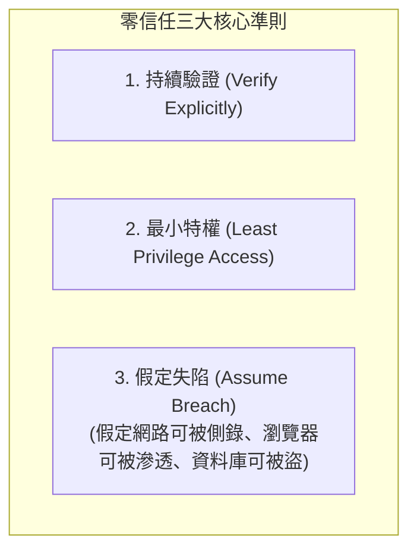
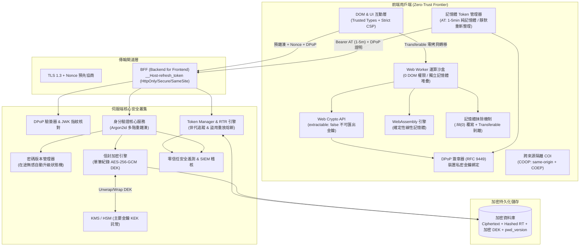

# WebApp Trust 🛡️
### 現代化 Web 應用零信任（Zero-Trust）全端身分驗證安全智慧體技能庫

[English](./README.md) | [简体中文](./readme-zh-hans.md) | 正體中文

[](#-核心安全架構圖)
[-green.svg)](./references/dpop-and-device-binding.md)
[](./references/passwordless-webauthn-totp.md)
[](./examples/)

`webapp-trust` 是專為 AI 程式設計智慧體及全端開發者打造的**通用零信任身分驗證與前端縱深防禦技能包**。它融合了現代密碼學、底層沙盒隔離與瀏覽器安全前沿標準，為 Web 應用程式提供從瀏覽器執行階段、傳輸鏈路到後端持久化儲存的全鏈路零死角防禦。

---

## 📦 安裝指南

使用以下指令一鍵將該技能安裝至你的 AI 智慧體環境中：

```bash
npx skills add koo14/webapp-trust
```

---

## 🌟 核心設計理念與安全特性



- 🔄 **單次密碼學 Nonce 防重放攻擊**：高安全驗證請求（登入、修改憑證、權杖重新整理等）強制伺服端預先協商簽發 Nonce，使用後原子核銷（`GETDEL` 語意）並鏈式輪換，從源頭阻斷重放攻擊。
- ⏳ **超短效雙 Token 與滾動輪換 (RTR)**：
  - **Access Token (AT)**：有效期限僅 **1 ~ 5 分鐘**，僅儲存在應用程式**記憶體變數**（JS 閉包 / Web Worker）中，**分頁關閉即刻銷毀，完全不落地至磁碟**。
  - **Refresh Token (RT)**：有效期限 **1 ~ 3 天**，儲存在具備 `HttpOnly; Secure; SameSite=Strict/Lax` 屬性的 Cookie 中，**徹底防範 JS 腳本讀取與 XSS 竊取**。
  - **重放熔斷 (Breach Detection)**：偵測到舊 RT 再次提交時，立即觸發**家族級聯註銷（Cascading Revocation）**，瞬間作廢該裝置的全量工作階段。
- 🔑 **Web Crypto「不可匯出金鑰」與 DPoP 裝置綁定 (RFC 9449)**：
  - 瀏覽器透過 `SubtleCrypto.generateKey()` 將 `extractable` 設為 `false`；私密金鑰原始位元組隔離在瀏覽器底層 C++/Rust 原生安全沙盒中，JS 僅持有不透明控制代碼。
  - 結合 RFC 9449 DPoP，每次高安全請求均由不可匯出私密金鑰即時簽章，**即使工作階段憑證外洩，攻擊者缺少實體裝置底層金鑰依然無法偽造請求**。
- 🧱 **密碼多階雜湊與在途無感版本遷移**：
  - 用戶端提早計算預雜湊（HMAC-SHA256），避免明文密碼在傳輸與內部網路流轉；伺服端接入 Argon2id / PBKDF2 多階加鹽雜湊。
  - 引入 `pwd_version` 密碼版本控制，舊版本使用者登入成功時在伺服端**自動無感升級至最新安全模型並重新加密**。
- 📦 **資料庫 KMS 信封加密 (Envelope Encryption)**：
  - 密碼雜湊值、TOTP 金鑰、WebAuthn 憑證均使用獨立的 256 位元 AES-GCM 資料加密金鑰（DEK）加密；DEK 由 KMS/HSM 主要金鑰（KEK）封裝，防範資料庫遭傾印洩密。
- 🧼 **WebAssembly 線性記憶體與顯式歸零清除**：
  - 敏感資料運算遷移至 Wasm 確定性線性記憶體，避開 JS 垃圾回收（GC）殘留；敏感 `Uint8Array` 用畢立即執行 `.fill(0)` 覆寫並解除引用。
- 🛡️ **瀏覽器原生縱深防禦**：
  - 開啟跨來源隔離（`COOP: same-origin` + `COEP: require-corp`）阻斷 Spectre 類側信道攻擊；
  - 強制 CSP 與 `Trusted Types`，從根源消除 DOM XSS 匯聚點。
- 🚀 **無密碼認證生態**：原生支援 FIDO2 / WebAuthn Passkeys 及防時間步重放的 TOTP（RFC 6238）。

---

## 🏛️ 核心安全架構圖



---

## 📁 目錄結構與模組索引

```text
.agents/skills/webapp-trust/
├── README.md                                 # 英文全景說明文件 (English)
├── readme-zh-hans.md                         # 簡體中文全景說明文件
├── readme-zh-hant.md                         # 正體中文全景說明文件（本檔案）
├── SKILL.md                                  # 智慧體主指令手冊（供 Antigravity 查閱）
│
├── references/                               # 深度技術規格與安全白皮書
│   ├── formal-security-model.md              # 0. 形式化信任邊界、敵手能力模型、五大安全不變量與狀態機
│   ├── zero-trust-auth-flow.md               # 1. Nonce 協商防重放、多階加鹽雜湊與密碼版本遷移機制
│   ├── tokens-and-rotation-lifecycle.md      # 2. 雙 Token (AT 1-5m + RT 1-3d) 生命週期、RTR 輪換與熔斷
│   ├── client-defense-and-webcrypto.md       # 3. 不可匯出金鑰、Wasm 線性記憶體、記憶體擦除、CSP/Trusted Types 及 COI
│   ├── memory-zeroization-and-physical-defense.md # 3b. 防編譯最佳化歸零 (Anti-DSE)、OS 傾印/越界防護與冷啟動防禦
│   ├── dpop-and-device-binding.md            # 4. DPoP (RFC 9449) 裝置綁定與 Web Crypto 簽章機制
│   ├── envelope-encryption-and-storage.md    # 5. KMS 信封加密 (DEK/KEK) 與資料庫密文表結構設計
│   ├── passwordless-webauthn-totp.md         # 6. Passkeys / WebAuthn 儀式與防重放 TOTP 規格
│   ├── bff-and-session-architecture.md       # 7. BFF 架構下沉與 __Host- HttpOnly Cookie 工作階段管理
│   └── audit-logging-and-threat-detection.md # 8. 零信任結構化稽核事件與 SIEM 威脅感知指標
│
└── examples/                                 # 生產級強型別參考實作 (TypeScript)
    ├── client/
    │   ├── crypto-sandbox.ts                 # 用戶端不可匯出金鑰生成、HMAC 預雜湊與記憶體歸零
    │   ├── auth.worker.ts                    # 獨立 Web Worker 運算沙盒
    │   ├── worker-bridge.ts                  # Transferable 記憶體零拷貝轉移與 Worker 瞬時銷毀
    │   ├── token-client.ts                   # 純記憶體 AT 管理、主動靜默重新整理與 DPoP 鑑權 Fetch 封裝
    │   ├── dpop-signer.ts                    # 用戶端 RFC 9449 DPoP Proof 簽章器
    │   └── webauthn-helper.ts                # Passkeys 註冊與登入儀式封裝
    ├── server/
    │   ├── nonce-handshake.ts                # 伺服端 Nonce 簽發、HMAC 簽章校驗與原子核銷輪換
    │   ├── token-manager.ts                  # 雙 Token 簽發、RTR 滾動輪換、世代比對與盜用熔斷引擎
    │   ├── envelope-encryption.ts            # DEK/KEK 信封加解密引擎與多版本密碼自動升級邏輯
    │   └── dpop-verifier.ts                  # 伺服端 DPoP Proof 驗簽與 JWK 指紋核對
    └── verification-suite.ts                 # 端到端全鏈路整合驗證與測試套件
```

---

## ⚡ 快速上手與整合範例

### 1. 用戶端：純記憶體 AT 發送 DPoP 鑑權請求
```typescript
import { ZeroTrustTokenClient } from "./examples/client/token-client";
import { generateNonExtractableSigningKey } from "./examples/client/crypto-sandbox";

// 1. 生成或載入瀏覽器不可匯出金鑰組 (extractable: false)
const keyPair = await generateNonExtractableSigningKey();

// 2. 初始化零信任 Token 用戶端
const authClient = new ZeroTrustTokenClient({
  bffBaseUrl: "https://api.yourdomain.com",
  keyPair,
  onAuthFailure: (err) => console.error("Session expired or revoked:", err),
});

// 3. 發送業務請求（自動處理記憶體 AT、靜默 Nonce 預檢與 DPoP 裝置私密金鑰簽章）
const response = await authClient.authenticatedFetch("/api/user/profile", {
  method: "GET",
});
const data = await response.json();
```

### 2. 伺服端：處理 Refresh Token 輪換與盜用重放防禦
```typescript
import { TokenManagerService } from "./examples/server/token-manager";

// 當用戶端存取 /auth/token/refresh 時觸發
try {
  const newTokens = await tokenManager.rotateRefreshToken(
    rawRefreshTokenFromCookie,
    "read:profile write:data",
    presentedDpopJkt
  );

  // 設定新一輪產生的 RT Cookie（1-3天滾動）
  res.setHeader("Set-Cookie", `__Host-refresh_token=${newTokens.rawRefreshToken}; Path=/auth/token/refresh; Secure; HttpOnly; SameSite=Strict; Max-Age=259200; Partitioned`);
  
  // 回傳有效期限 1-5 分鐘的記憶體 Access Token
  res.json({ accessToken: newTokens.accessToken, expiresIn: newTokens.expiresInSeconds });
} catch (error) {
  if (error.message.includes("BREACH_DETECTED")) {
    // 擷取到重放/盜用攻擊：家族全量工作階段已自動銷毀，通知前端登出
    res.status(401).json({ error: "TOKEN_COMPROMISED_FORCE_LOGOUT" });
  }
}
```

---

## 🧪 執行端到端整合驗證套件

技能庫內建了完整的模擬驗證腳本 [`verification-suite.ts`](./examples/verification-suite.ts)，涵蓋以下關鍵流程：

1. **Step 1-2**：伺服端簽發預先協商 Nonce $\to$ 用戶端 HMAC 預雜湊並使用 `.fill(0)` 立即抹除原始記憶體；
2. **Step 3-4**：資料庫載入 `v1` 舊版本使用者憑據 $\to$ 伺服端原子核銷 Nonce 並簽發輪換 Nonce；
3. **Step 5**：**防重放校驗**：模擬重放已核銷的 Nonce，驗證伺服端成功識別並堅決拒絕；
4. **Step 6-7**：**在途無感版本升級**：校驗舊密碼成功後，自動使用 Argon2id 重新加鹽雜湊並經 KMS 信封加密更新至 `v2`；
5. **Step 8-10**：**雙 Token 簽發與 RTR**：簽發 180s AT 與 3d RT，執行一次正常的權杖輪換（$G_0 \to G_1$）；
6. **Step 11-12**：**權杖盜用重放熔斷**：模擬重放舊世代 $G_0$ 權杖，系統成功捕捉並觸發全家族銷毀，驗證 $G_1$ 隨即失效。

---

## 📜 遵循的安全標準與規範

- **零信任架構**：[NIST SP 800-207 Zero Trust Architecture](https://csrc.nist.gov/publications/detail/sp/800-207/final)
- **裝置持有證明**：[RFC 9449 OAuth 2.0 Demonstrating Proof of Possession (DPoP)](https://datatracker.ietf.org/doc/html/rfc9449)
- **一次性動態密碼**：[RFC 6238 TOTP: Time-Based One-Time Password Algorithm](https://datatracker.ietf.org/doc/html/rfc6238)
- **Web 身分認證標準**：[W3C Web Authentication (WebAuthn) Level 3](https://www.w3.org/TR/webauthn-3/)
- **應用安全驗證標準**：[OWASP ASVS v4.0.3 (Authentication & Session Management)](https://owasp.org/www-project-application-security-verification-standard/)
