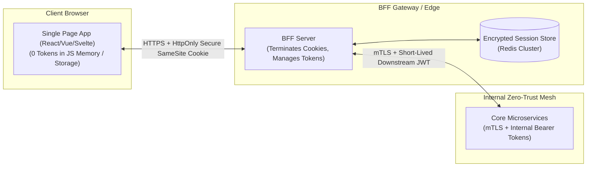

# BFF (Backend for Frontend) & Session Architecture

Storing session tokens or JWTs inside browser storage (`localStorage`, `sessionStorage`, or JavaScript in-memory variables) exposes them to direct exfiltration via Cross-Site Scripting (XSS) or malicious third-party dependencies.

---

## 1. Architectural Sinking via BFF

The Backend for Frontend (BFF) acts as a reverse proxy and security termination gateway. It translates public browser sessions into authenticated internal downstream requests.



---

## 2. Cookie Security Attributes

Cookies issued by the BFF must enforce the following flags:

```http
Set-Cookie: __Host-refresh_token=rt_RANDOM_SESSION_ID;
            Path=/auth/token/refresh;
            Secure;
            HttpOnly;
            SameSite=Strict; -- or SameSite=Lax
            Max-Age=259200;
```

### Attribute Breakdown:
- **`__Host-` Prefix**: Enforces that the cookie cannot be overwritten by subdomains and must have `Path=/` (or `/auth/token/refresh`) and `Secure`.
- **`HttpOnly`**: Blocks all JavaScript access via `document.cookie`, completely eradicating XSS extraction.
- **`Secure`**: Enforces transmission exclusively over TLS 1.3/1.2.
- **`SameSite=Strict` (or `SameSite=Lax`)**: Blocks cookie inclusion in untrusted cross-site requests, eliminating CSRF.
- **`Path=/auth/token/refresh`**: Restricts the transmission of `__Host-refresh_token` exclusively to the token refresh endpoint, preventing the refresh token from being attached to ordinary API requests.

---

## 3. Dual-Token Model: BFF vs. Client Roles

| Token | Storage Location | Lifetime | Transmission | Purpose |
| :--- | :--- | :--- | :--- | :--- |
| **Access Token (AT)** | Application In-Memory Variable (0 disk presence, destroyed on page/tab close) | **1 - 5 min** | `Authorization: Bearer <AT>` + `DPoP: <Proof>` | Direct API calls & Downstream microservices |
| **Refresh Token (RT)** | BFF Cookie (`__Host-refresh_token` with `HttpOnly`, `Secure`, `SameSite=Strict/Lax`) | **1 - 3 days** | `Cookie: __Host-refresh_token=...` | RTR silent token renewal at `/auth/token/refresh` |


---

## 4. Session Revocation & Invalidation

1. **Instant Global Revocation**: Removing the session record or Token Family from the BFF Redis cache terminates the session immediately across all tabs and devices.
2. **Cascading Breach Invalidation**: If an old Refresh Token is replayed, the BFF invalidates the entire token family, purges all associated ATs, and revokes all active cookies.
3. **Session Hijacking Defense**:
   - Bind sessions and tokens to client fingerprint characteristics (JA3/TLS fingerprint, Client IP subnet, User-Agent) and DPoP device keys.
   - Require re-authentication with nonce for step-up actions if network posture changes.

