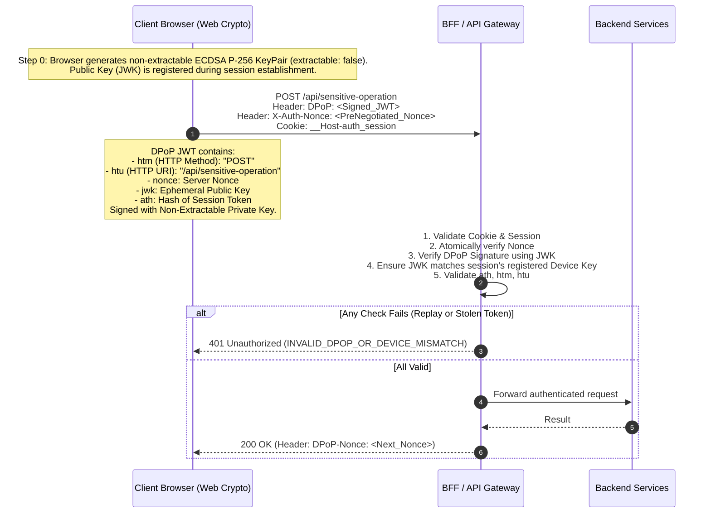

# DPoP (Demonstrating Proof-of-Possession) & Device Binding

While `HttpOnly` and `SameSite` cookies eliminate direct JavaScript extraction of session tokens, an attacker with local proxy access or network tap could potentially replay captured tokens if not bound to the client device.

RFC 9449 (DPoP) combined with **Web Crypto Non-Extractable Keys** provides end-to-end device binding under Zero-Trust.

---

## 1. DPoP Zero-Trust Flow with Non-Extractable Keys



---

## 2. DPoP Proof Structure

A DPoP proof is a compact JWT signed with the client's non-extractable private key:

### DPoP Header:
```json
{
  "typ": "dpop+jwt",
  "alg": "ES256",
  "jwk": {
    "kty": "EC",
    "crv": "P-256",
    "x": "f83OJ3D2xFMTbKEBaNk-8qnviRtWmOiEUAENv95460Y",
    "y": "x_daQgahOu01DEtoNphbGwoxQh42eB2ng-144214534"
  }
}
```

### DPoP Payload:
```json
{
  "jti": "b3c66f5a-2e4d-44a6-8092-234b07d612e4",
  "htm": "POST",
  "htu": "https://api.domain.com/auth/modify-credentials",
  "iat": 1718000000,
  "nonce": "server_negotiated_nonce_abc123",
  "ath": "fUHyO2R2Z3DZ520SNSnAlryznJe9WHLocnqDex6P864"
}
```

---

## 3. Security Properties
1. **Theft Immunity**: Even if an adversary intercepts the session cookie, they cannot forge a valid DPoP proof because the private key cannot be exported from the legitimate user's browser sandbox.
2. **Path & Method Pinning**: The proof explicitly binds to `htm` and `htu`, preventing cross-endpoint token relay.
3. **Nonce Anti-Replay Coupling**: The DPoP payload directly embeds the server-issued cryptographic nonce.
