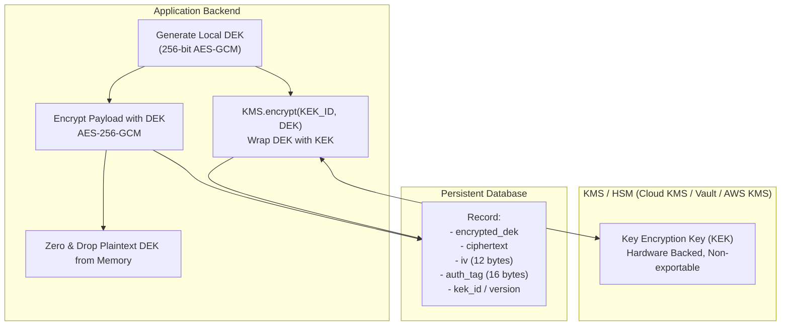
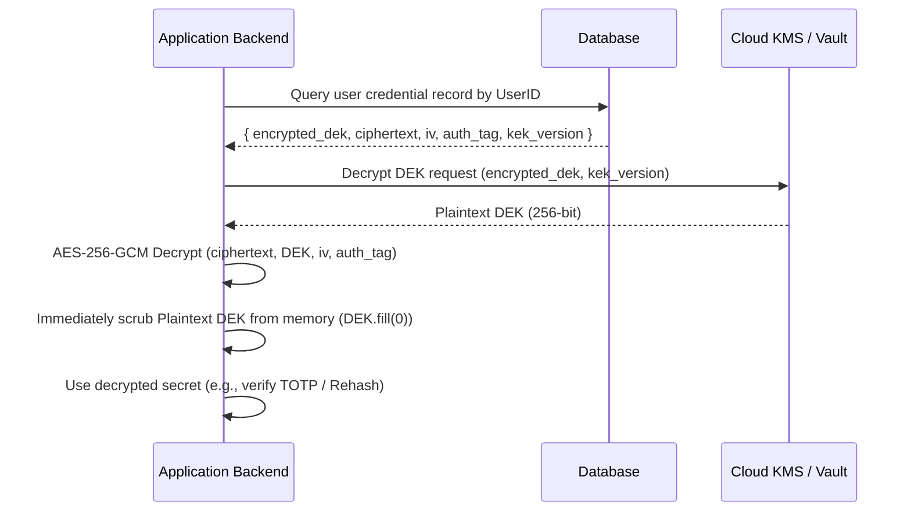

# Envelope Encryption & Secure Storage Architecture

Storing plaintext authentication secrets (password verifiers, TOTP seeds, WebAuthn credentials, OAuth refresh tokens) in relational or NoSQL databases exposes the system to catastrophic compromise in the event of database dumps or SQL injection vulnerabilities.

---

## 1. Envelope Encryption Concept (KEK & DEK)

Envelope encryption separates key management from data encryption:



### Definitions:
- **KEK (Key Encryption Key)**: Stored strictly inside a Hardware Security Module (HSM) or managed Cloud KMS (AWS KMS, Google Cloud KMS, HashiCorp Vault). It never leaves the HSM boundary.
- **DEK (Data Encryption Key)**: A fast, ephemeral symmetric key (AES-256) generated by the application for a single record or tenant.
- **Envelope**: The ciphertext of the data packaged together with the KEK-encrypted DEK.

---

## 2. Decryption Workflow



---

## 3. Database Schema Specification

```sql
-- User Authentication & Credentials Schema
CREATE TABLE user_credentials (
    user_id UUID PRIMARY KEY,
    
    -- Password Model & Versioning
    pwd_version VARCHAR(16) NOT NULL DEFAULT 'v2',
    pwd_hash_ciphertext BYTEA NOT NULL,
    pwd_hash_iv BYTEA NOT NULL,
    pwd_hash_tag BYTEA NOT NULL,
    pwd_encrypted_dek BYTEA NOT NULL,
    pwd_kek_id VARCHAR(64) NOT NULL,
    pwd_salt BYTEA NOT NULL,

    -- TOTP Credentials (RFC 6238)
    totp_enabled BOOLEAN NOT NULL DEFAULT FALSE,
    totp_secret_ciphertext BYTEA,
    totp_secret_iv BYTEA,
    totp_secret_tag BYTEA,
    totp_encrypted_dek BYTEA,
    totp_kek_id VARCHAR(64),
    totp_last_verified_step BIGINT, -- Prevents TOTP replay

    -- Audit & Lifecycle
    created_at TIMESTAMPTZ NOT NULL DEFAULT NOW(),
    updated_at TIMESTAMPTZ NOT NULL DEFAULT NOW()
);

-- Passkey / WebAuthn Credentials
CREATE TABLE user_webauthn_credentials (
    credential_id BYTEA PRIMARY KEY,
    user_id UUID NOT NULL REFERENCES user_credentials(user_id) ON DELETE CASCADE,
    public_key BYTEA NOT NULL,
    sign_count BIGINT NOT NULL DEFAULT 0,
    transports TEXT[],
    aaguid UUID,
    created_at TIMESTAMPTZ NOT NULL DEFAULT NOW()
);
```

---

## 4. Key Rotation Strategy

1. **KEK Rotation**:
   - Managed automatically by Cloud KMS (e.g., annual rotation).
   - Old KEK versions remain available for decryption, while new encryptions use the latest KEK version.
2. **DEK Re-wrapping without Re-encrypting Data**:
   - When migrating KEKs, the application queries records, sends `encrypted_dek` to KMS `re-encrypt` (which unwraps with old KEK and wraps with new KEK inside KMS), and updates `pwd_encrypted_dek` in the DB.
   - The large payload ciphertext does not need to be decrypted into memory.
