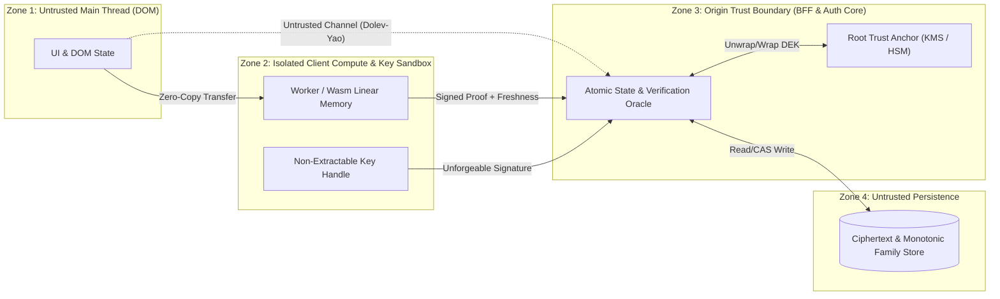
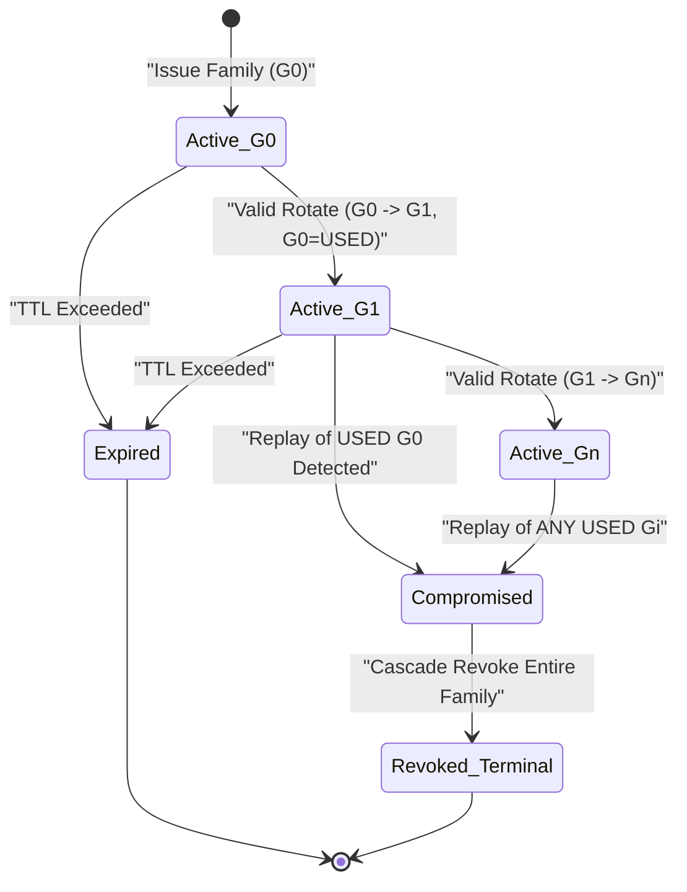
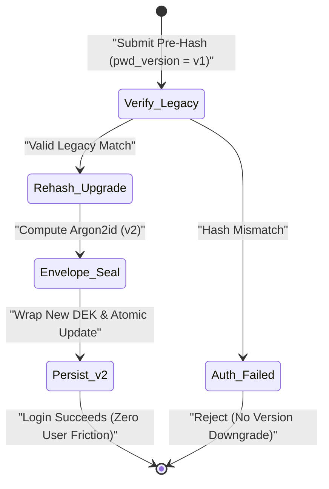

# Formal Security Model, Adversary Abstractions & Cryptographic Invariants

> **Scope**: This specification defines the **protocol-agnostic theoretical foundation** behind `webapp-trust`. All concrete browser APIs (`Web Crypto`, `HttpOnly` cookies, `Argon2id`, `DPoP`) are platform instantiations of the axioms, invariants, and state machines defined below.

---

## 1. Trust Boundaries & Capability-Based Adversary Model

A zero-trust authentication system rejects implicit trust in any single execution layer (client runtime, transport intermediary, or persistent storage). Instead, security guarantees are proven under **explicit adversary capability assumptions**:

| Adversary Class | Assumed Capabilities | Explicit Boundary (What Remains Uncompromised) |
| :--- | :--- | :--- |
| **$\mathcal{A}_{\text{net}}$ (Dolev-Yao Network)** | Eavesdrop, intercept, replay, reorder, or inject packets; terminate TLS at untrusted proxies/CDNs. | End-to-end cryptographic integrity & freshness verified by the origin auth boundary. |
| **$\mathcal{A}_{\text{client}}$ (DOM / XSS Injection)** | Execute arbitrary main-thread JavaScript; read DOM, `localStorage`, `sessionStorage`, and non-`HttpOnly` cookies. | Browser native C++/Rust key sandbox (`extractable: false`), `HttpOnly` cookie jar, and isolated Worker/Wasm memory. |
| **$\mathcal{A}_{\text{store}}$ (Storage / Snapshot)** | Obtain full cold dumps of primary databases, backups, and ciphertext blobs. | Hardware-backed Root Key Encryption Keys (KEK) inside KMS/HSM; high-entropy client pre-hash + server Argon2id work factor. |
| **$\mathcal{A}_{\text{post}}$ (Post-Compromise Lateral)** | Exfiltrate a valid short-lived Access Token ($AT$) or steal a single Refresh Token ($RT_i$) at time $t$. | Non-extractable device private key ($k_{\text{priv}}$) and monotonic family state machine on the server. |

---

## 2. Five Protocol-Agnostic Security Invariants

Every concrete control in this skill exists to enforce one or more of the following five invariants:

### Invariant I1 — State Freshness & Atomic Consumption (Anti-Replay)
Every state-mutating authentication or credential transaction requires a server-issued challenge $n \in \{0,1\}^{128+}$ bound to a strict validity window $\Delta t$:
$$\text{Accept}(n) \implies \text{AtomicConsume}(n) = \text{true} \quad \land \quad \forall t' > t_{\text{consume}}:\ \text{Accept}(n) = \text{false}$$
- **Failure Mode**: Fail-closed. Missing, expired, or previously consumed challenges must abort before any expensive cryptographic or database mutation executes.

### Invariant I2 — Sender-Constrained Proof-of-Possession
A bearer credential $C$ alone is insufficient to authorize a request $R = (\text{method}, \text{uri}, t, n)$. Authorization requires a cryptographic proof bound to both the request context and a non-exportable device key $k_{\text{priv}}$:
$$\text{Authorized}(R, C, \sigma) \iff \text{Valid}(C) \land \text{Verify}_{k_{\text{pub}}}(R \| H(C), \sigma) \land \text{Thumbprint}(k_{\text{pub}}) = C_{\text{cnf}}$$
- **Consequence**: Exfiltration of $C$ over the network or from memory without physical access to $k_{\text{priv}}$ yields zero replayable capability ($\mathcal{A}_{\text{post}}$ containment).

### Invariant I3 — Monotonic Generation & Blast-Radius Containment
Long-lived session continuity is modeled as a strictly monotonic sequence within a family $F$: $G_0 \to G_1 \to \dots \to G_k$, where at most one generation is `ACTIVE` at any instant:
$$\text{Present}(G_i) \text{ where } G_i.\text{status} = \text{USED} \implies \forall j \ge 0:\ G_j.\text{status} \leftarrow \text{REVOKED}$$
- **Consequence**: Any race or reuse of a retired generation collapses the entire family state machine to `REVOKED`, bounding the post-compromise window to at most a single round-trip.

### Invariant I4 — Hierarchical Key Isolation (Blast-Radius Decoupling)
No persistent record shares a Data Encryption Key ($\text{DEK}_r$) with another record, and no $\text{DEK}_r$ is ever persisted in plaintext alongside ciphertext:
$$\text{Record}_r = \left(\text{Enc}_{\text{DEK}_r}(M_r),\ \text{Wrap}_{\text{KEK}_v}(\text{DEK}_r),\ v\right)$$
- **Consequence**: Compromise of $\text{DB}$ ($\mathcal{A}_{\text{store}}$) reveals only ciphertext; compromise of a single unwrapped $\text{DEK}_r$ affects only record $r$.

### Invariant I5 — Ephemeral Secret Residency & Anti-Extraction Zeroization
Plaintext secrets (raw passwords, unhashed tokens, raw key bytes) must have a bounded residency $T_{\text{res}} \to 0$ in garbage-collected heaps and **zero residency** in durable client storage (`localStorage`, `IndexedDB` plaintext, swap/core dumps):
$$\text{Lifecycle}(\text{Secret}) = \text{Lock/Isolate} \to \text{Transform/Sign} \to \text{BarrieredZero}(\texttt{0x00}) \to \text{Unlock/Dereference}$$
- **Compiler, OS & Physical Enforcement**: Zeroization must survive compiler Dead Store Elimination (DSE), exclude pages from swap/core dumps (`mlock`, `MADV_DONTDUMP`), and keep root keys inside hardware/non-extractable boundaries against cold-boot and DMA extraction (see [Memory Zeroization & Physical Defense](./memory-zeroization-and-physical-defense.md)).

---

## 3. Deterministic Security State Machines (FSM)

### 3.1 Token Family Lifecycle & Breach Collapse

### 3.2 In-Flight Credential Version Migration

---

## 4. Protocol-Agnostic Primitives & Platform Instantiation

To apply this architecture across Web, Native Mobile, Edge Workers, or Service-to-Service APIs, bind the abstract primitives below to your target runtime:

| Abstract Primitive | Formal Responsibility | Web / BFF Instantiation (`examples/`) | Alternative Runtime Instantiation |
| :--- | :--- | :--- | :--- |
| **`AtomicChallengeOracle`** | Issue bounded-TTL challenges; enforce single-use `GETDEL` consumption. | `NonceHandshakeService` + Redis `GETDEL` | Edge KV / Durable Objects atomic state |
| **`NonExtractableSigner`** | Generate hardware/sandbox-bound keypair; sign context without exposing raw private bytes. | `SubtleCrypto` (`extractable: false`) + `dpop-signer.ts` | iOS Secure Enclave / Android Keystore / TPM |
| **`MonotonicSessionGraph`** | Track token family generations; enforce CAS rotation & cascading revocation. | `TokenManagerService` + `__Host-` `HttpOnly` Cookie | mTLS-bound refresh store / OAuth2 AS |
| **`EnvelopeCipher`** | Encrypt per-record secrets with unique DEK; wrap DEK via external root KEK. | `EnvelopeEncryptionService` + Cloud KMS | HashiCorp Vault Transit / AWS KMS / Cloud HSM |
| **`EphemeralMemoryRegion`** | Isolate secret derivation from UI/DOM; scrub buffers deterministically. | Web Worker + Wasm Linear Memory + `.fill(0)` | Native `mlock` + `explicit_bzero` / Rust `zeroize` |

---

## 5. Composition Rules & Engineering Trade-offs

1. **Defense-in-Depth Composition**: No single invariant covers all adversaries. For example, `HttpOnly` cookies neutralize $\mathcal{A}_{\text{client}}$ exfiltration of $RT$, while DPoP (I2) neutralizes $\mathcal{A}_{\text{post}}$ replay of $AT$, and RTR (I3) detects $\mathcal{A}_{\text{post}}$ theft of $RT$.
2. **Fail-Closed Default**: On clock skew beyond `maxAgeSeconds`, missing `ath` when an access token is presented, or KMS unwrap failure, the system must reject the transaction rather than degrading to bearer-only mode.
3. **Concurrency vs. Strict Nonce Serialization**: Enforcing I1 on every API call can cause race conditions under parallel browser requests. Mitigate via a **client-side request serialization queue** for token/nonce-mutating endpoints, or server-issued `DPoP-Nonce` challenge-retry semantics.
4. **Progressive Adoption**: Strict `COOP: same-origin` + `COEP: require-corp` and `Trusted Types` provide strong isolation against side-channels and DOM XSS, but may conflict with third-party OAuth popups or legacy embeds. Adopt them incrementally per security tier (Baseline $\to$ Standard $\to$ High-Assurance).
