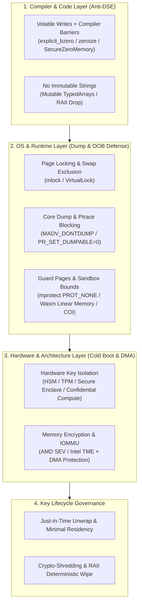

# Secure Data Erasure (Zeroization) & Physical/Memory Extraction Defense

Even when cryptographic protocols are mathematically sound, secrets (private keys, DEKs, plaintext passwords, session seeds) remain vulnerable during their **in-memory residency window** to compiler optimizations, OS core dumps, out-of-bounds (OOB) reads, and physical cold-boot attacks.

This specification defines mandatory zeroization and memory-hardening controls across four layers: **Compiler & Code**, **OS & Runtime**, **Hardware & Architecture**, and **Key Lifecycle Governance**.



---

## 1. Compiler & Code Layer: Preventing Zeroization Optimization (Anti-DSE)

Modern optimizing compilers (LLVM/Clang, GCC, MSVC, V8 TurboFan) perform **Dead Store Elimination (DSE)**. If a buffer is overwritten with `0x00` right before going out of scope or being freed, and the buffer is never read again, the compiler may legally **delete the zeroization loop entirely**.

### Mandatory Controls

| Language / Runtime | Vulnerable Pattern (Avoid) | Hardened Zeroization Pattern (Required) |
| :--- | :--- | :--- |
| **C / C++** | `memset(buf, 0, len);` before `free()` or return | `explicit_bzero(buf, len)` (BSD/glibc), `memset_s(buf, max, 0, len)` (C11 Annex K), `SecureZeroMemory()` (Windows), or `volatile uint8_t *p` write + `__asm__ __volatile__("" : : "r"(p) : "memory")` |
| **Rust** | Manual `for b in buf.iter_mut() { *b = 0; }` | `zeroize` crate (`Zeroize` / `ZeroizeOnDrop`), which uses `ptr::write_volatile` + `core::sync::atomic::compiler_fence(Ordering::SeqCst)` |
| **WebAssembly (Rust/C -> Wasm)** | Relying on JS GC after Wasm call | Zeroize inside Wasm via `ZeroizeOnDrop` **and** verify `.wasm` disassembly does not elide stores; zero shared `WebAssembly.Memory` views before returning |
| **JavaScript / TypeScript** | Storing secrets in `string` (immutable, interned) | Use `Uint8Array` inside `try { ... } finally { buf.fill(0); }` within an isolated Web Worker, then `worker.terminate()` or Transferable detach |

### Reference Implementations

```rust
// Rust (Native & Wasm): Deterministic zeroization guaranteed across panic/early-return
use zeroize::{Zeroize, ZeroizeOnDrop};

#[derive(Zeroize, ZeroizeOnDrop)]
struct EphemeralDek {
    key_bytes: [u8; 32],
}
```

```c
// C: Compiler-barrier-protected zeroization (immune to DSE)
void secure_zero(void *ptr, size_t len) {
    volatile unsigned char *p = (volatile unsigned char *)ptr;
    while (len--) {
        *p++ = 0;
    }
    __asm__ __volatile__("" : : "r"(ptr) : "memory");
}
```

---

## 2. OS & Runtime Layer: Restricting Memory Dumps & Out-of-Bounds Reads

### 2.1 Swap, Hibernation, and Core Dump Exclusion
If an OS pages secret-bearing RAM to disk (`swap` / `pagefile.sys` / hibernation image) or writes a crash core dump, zeroization in RAM is rendered ineffective.
- **Lock Sensitive Pages in RAM**: Use `mlock()` / `mlock2()` (POSIX/Linux) or `VirtualLock()` (Windows) for native key-handling buffers so they are never swapped to disk. Unlock (`munlock()`) only **after** secure zeroization.
- **Exclude from Core Dumps**:
  - Linux: Mark sensitive memory regions with `madvise(addr, len, MADV_DONTDUMP)`.
  - Process-wide: Set `RLIMIT_CORE = 0` and `prctl(PR_SET_DUMPABLE, 0)` (also blocks non-root `ptrace` attachment / `/proc/<pid>/mem` reads).
  - Windows: Avoid `MiniDumpWithFullMemory` in crash reporters for auth/KMS services.

### 2.2 Out-of-Bounds (OOB) & Speculative Read Mitigation
- **Guard Pages**: Surround sensitive native allocations with `PROT_NONE` guard pages (`mprotect`) to turn linear OOB reads/writes (Heartbleed-style) into immediate `SIGSEGV` crashes rather than silent memory disclosure.
- **Bounds-Checked Sandboxes**: Execute untrusted parsing and client-side crypto inside WebAssembly linear memory (bounds-checked by the Wasm runtime) and isolated Web Workers (`0` DOM access).
- **Constant-Time Operations**: Compare MACs, HMACs, and password hashes strictly with constant-time primitives (`crypto.timingSafeEqual`) to prevent cache-timing OOB/side-channel inference.
- **Browser Speculative Execution Defense**: Enforce Cross-Origin Isolation (`COOP: same-origin` + `COEP: require-corp`) to mitigate Spectre-class microarchitectural memory reads.

---

## 3. Hardware & Architecture Layer: Defending Against Cold Boot & Physical Extraction

In a **Cold Boot Attack**, an attacker physically chills DRAM modules (slowing charge decay from milliseconds to minutes), cuts power, and reads raw memory contents from another machine or via DMA.

### Architectural Defenses
1. **Never Expose Root Keys to Host DRAM**:
   - **Server**: Keep Master Key Encryption Keys (KEKs) inside **HSM / Cloud KMS**. Perform DEK unwrapping inside KMS or hardware-isolated enclaves.
   - **Client**: Generate device-binding keys with `Web Crypto` (`extractable: false`) backed by OS Keychain / TPM / Secure Enclave so raw private key bytes never enter JS or unprivileged host RAM.
2. **Hardware Memory Encryption & Confidential Computing**:
   - Enable full-memory encryption (**AMD SME/SEV-SNP**, **Intel TME/MKTME/TDX**) on auth servers and KMS proxies so physical DRAM contents remain encrypted against cold-boot and bus-snooping attacks.
3. **DMA & Physical Port Hardening**:
   - Enable **IOMMU** (`Intel VT-d` / `AMD-Vi`) and Kernel DMA Protection to prevent rogue PCIe/Thunderbolt/USB4 devices from reading key-bearing physical memory.
4. **Power-State & Tamper Zeroization**:
   - Trigger immediate zeroization of cached keys on sleep/suspend/hibernate transitions or hardware tamper signals; disable hibernation on high-assurance auth nodes.

---

## 4. Key Lifecycle Governance Principles

| Principle | Operational Rule | Failure / Violation Example |
| :--- | :--- | :--- |
| **1. Just-in-Time (JIT) Materialization** | Unwrap or derive a DEK/secret only at the exact millisecond of cryptographic use; zeroize immediately after. | Pre-loading unwrapped DEKs into an in-memory Redis/LRU cache for hours. |
| **2. Minimal Residency ($T_{\text{res}} \to 0$)** | Enforce RAII (`ZeroizeOnDrop`) or `try ... finally` scoping so exceptions/panics cannot skip zeroization. | Zeroizing only on the `return ok;` path while leaking secrets on `throw` / `Err`. |
| **3. Non-Extractability by Default** | Prefer opaque hardware/sandbox handles (`extractable: false`, KMS key IDs) over raw key material in application memory. | Exporting `CryptoKey` to JWK/raw bytes for convenience in client JS. |
| **4. Crypto-Shredding & Key Separation** | Separate KEK custody (KMS/HSM) from ciphertext storage (DB); revoke/destroy KEK/DEK to render backups unreadable. | Storing KEK or unwrapped DEK in `.env` or alongside DB snapshots. |
| **5. CI / Binary Verification** | Audit compiled binaries/Wasm for DSE removal of wipes; run heap-snapshot & core-dump leak tests in CI. | Assuming `memset` or `arr.fill(0)` survived `-O3` / JIT optimization without verification. |
