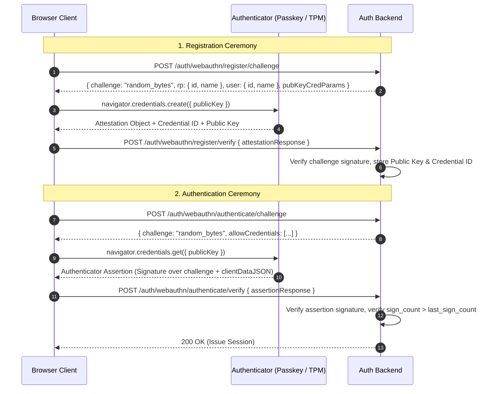

# Passwordless Authentication: WebAuthn & TOTP

Passwordless authentication eliminates credential stuffing and phishing risks by shifting identity proof to cryptographic signatures and hardware security keys.

---

## 1. WebAuthn / Passkeys Architecture

WebAuthn utilizes public-key cryptography where the private key is generated inside an authenticator's hardware security module (Secure Enclave, TPM, YubiKey) and never leaves the device.

### Security Controls:
1. **Challenge Nonce**: Challenge must be high-entropy random bytes with a 60-second TTL.
2. **Origin & RP ID Validation**: Strictly verify `clientDataJSON.origin` matches the exact application domain.
3. **Sign Count Monotonicity**: Ensure `sign_count` is monotonically increasing to detect cloned authenticators.

---

## 2. Time-Based One-Time Password (TOTP, RFC 6238)

TOTP provides a secondary or standalone passwordless factor based on symmetric HMAC-SHA1/SHA256 evaluated over time windows (typically 30 seconds).

### Algorithm:
$$\text{TOTP}(K, T) = \text{Truncate}(\text{HMAC-SHA256}(K, \lfloor(T - T_0) / T_X\rfloor)) \pmod{10^6}$$

Where:
- $K$: Envelope-encrypted shared secret seed (minimum 160 bits).
- $T$: Current UNIX timestamp in seconds.
- $T_X$: Time step interval (default: 30 seconds).

### Anti-Replay & Time Drift Mitigation:
1. **Window Tolerance**: Accept the current window $W_0$, previous window $W_{-1}$, and next window $W_{+1}$ to accommodate clock skew.
2. **Replay Suppression**: Maintain `totp_last_verified_step` in the user record. If the submitted OTP corresponds to a time step $\le \text{totp\_last\_verified\_step}$, reject the code immediately, even if it is mathematically valid within the window.
3. **Envelope Encryption**: TOTP secret seeds must never be stored in plaintext. They are encrypted using the application's KMS DEK.
