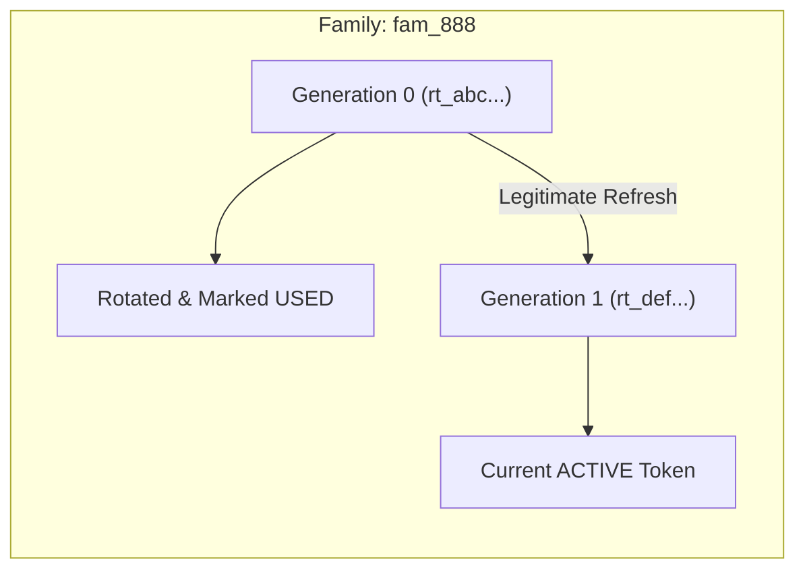
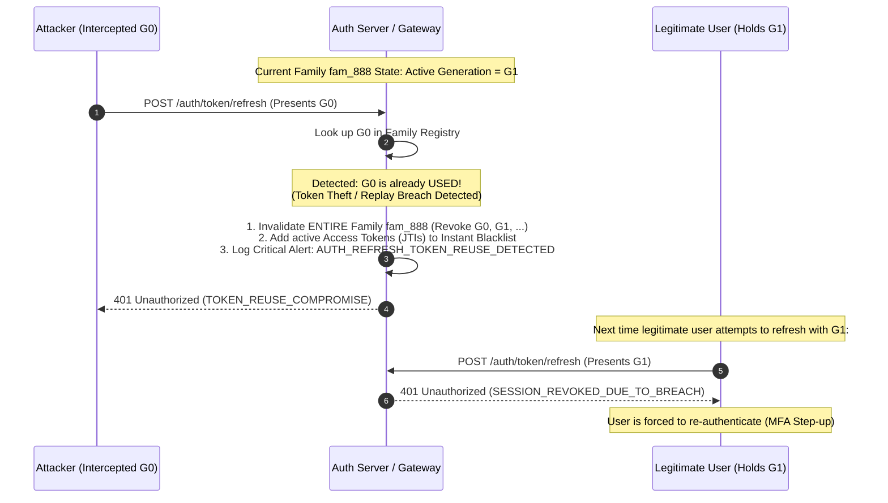

# Access Token + Refresh Token Lifecycle & Rotation (Zero-Trust Standard)

In modern Zero-Trust architectures, authentication tokens must follow strict least-privilege, short lifetimes, explicit device binding, and cryptographic rotation with breach detection.

---

## 1. Token Architecture & Dual-Token Model

```mermaid
flowchart TB
    subgraph Client ["Client Browser (Zero-Trust Frontier)"]
        DPoP["Web Crypto Non-Extractable Key<br/>(DPoP Signer)"]
        MemAT["In-Memory Variable AT<br/>(1-5 min TTL, Destroyed on Page Close, 0 Disk Storage)"]
        CookieRT["__Host-refresh_token Cookie<br/>(HttpOnly, Secure, SameSite=Strict/Lax, Path=/auth)"]
    end

    subgraph Gateway ["BFF / Token Gateway"]
        NonceVal["Nonce Anti-Replay Verifier"]
        DPoPVal["DPoP & Device Thumbprint Verifier"]
        RTR["RTR Engine (Rotation & Reuse Detector)"]
    end

    subgraph Storage ["Encrypted Session / Token Store"]
        FamilyStore[("Token Family Registry<br/>(Family ID, Generation, Hash, Status)")]
        KMS["KMS Envelope Encryption"]
    end

    Client -->|1. Initial Auth + Nonce + DPoP| Gateway
    Gateway -->|2. Issue Short-lived AT (1-5m) + HttpOnly RT| Client
    Client -->|3. API Request: Bearer AT + DPoP Proof| Gateway
    Client -->|4. Silent Refresh: HttpOnly RT + Nonce + DPoP| Gateway
    Gateway <--> RTR
    RTR <--> FamilyStore
    FamilyStore <--> KMS
```

---

## 2. Token Specifications & Storage Boundaries

### Access Token (AT)
- **Lifetime**: **1 to 5 minutes** (Ultra short-lived ephemeral credential).
- **Format**: Signed JWT (ES256 / Ed25519) or PASETO v4.
- **Client Storage**: **Application in-memory variable only** (e.g., JavaScript closure variable or Web Worker instance memory).
  - **Zero Disk Persistence**: Strictly forbidden in `localStorage`, `sessionStorage`, IndexedDB, or document cookies.
  - **Instant Lifecycle Termination**: The moment the user closes the browser tab, window, or navigates away, the in-memory variable is destroyed and permanently reclaimed by the OS process.
- **Standard Claims**:
  ```json
  {
    "iss": "https://auth.yourdomain.com",
    "sub": "usr_9a8b7c6d5e4f",
    "aud": "https://api.yourdomain.com",
    "iat": 1718000000,
    "exp": 1718000180,
    "jti": "at_b1c2d3e4f5a6b7c8",
    "scope": "read:profile write:data",
    "cnf": {
      "jkt": "0ZcOCORZTXCrMwuzrZvxF3VNj2b00_0KdW..."
    }
  }
  ```
  - `cnf.jkt`: SHA-256 thumbprint of the client's Web Crypto Non-extractable DPoP public key. Any request presenting this AT must also provide a valid DPoP proof signed by the corresponding private key.

### Refresh Token (RT)
- **Lifetime**: **1 to 3 days** (86,400s – 259,200s rolling expiration window).
- **Format**: 256-bit cryptographically secure random entropy or signed token containing `family_id` and `generation`.
- **Client Storage**: Sunk exclusively into a browser Cookie with strict flags:
  ```http
  Set-Cookie: __Host-refresh_token=rt_RANDOM_256BIT_ENTROPY;
              Path=/auth/token/refresh;
              Secure;
              HttpOnly;
              SameSite=Strict;
              Max-Age=259200;
              Partitioned;
  ```
  - **`HttpOnly`**: Completely isolates the cookie from JavaScript (`document.cookie`), eradicating XSS token theft.
  - **`Secure`**: Enforces delivery exclusively over TLS encrypted channels.
  - **`SameSite=Strict` (or `SameSite=Lax` for external redirect flows)**: Prevents CSRF token transmission on cross-origin requests.
  - **`Path=/auth/token/refresh`**: Confines RT transmission strictly to the refresh endpoint.
- **Server Storage**: **NEVER stored in plaintext**. Stored as a SHA-256 digest or envelope-encrypted (KMS DEK/KEK) within the database/Redis cache.

---

## 3. Refresh Token Rotation (RTR) & Reuse Detection

To prevent token theft and replay attacks, every refresh operation executes **Refresh Token Rotation (RTR)**.

### Token Family & Generation Model
Every session is assigned a unique `family_id`. Within this family, tokens advance through monotonic generations ($G_0 \to G_1 \to G_2 \to \dots$).



### Breach Detection & Automatic Family Invalidation (Cascading Revocation)

If an attacker intercepts $G_0$ and attempts to refresh after the legitimate user has already refreshed to $G_1$:



---

## 4. Zero-Trust Refresh Handshake Workflow

The `/auth/token/refresh` endpoint must enforce all three Zero-Trust pillars:

1. **Anti-Replay Nonce**: Client must acquire a pre-negotiated server nonce (`X-Auth-Nonce`) before calling refresh.
2. **DPoP Device Binding**: Client must sign the refresh request using its non-extractable Web Crypto private key (`DPoP: <Signed_JWT>`), binding the request to `htm=POST`, `htu=/auth/token/refresh`, and `nonce`.
3. **Atomic Rotation**: Server atomically validates the nonce, consumes the old RT, registers the new RT generation, issues a new short-lived AT, and returns the new rotated RT via `Set-Cookie`.

---

## 5. Revocation Strategies

1. **Single Family Revocation (`revokeFamily(familyId)`)**: Revokes a specific device/browser session.
2. **Global User Revocation (`revokeAllUserSessions(userId)`)**: Invalidates all token families for the user (used upon password change, account recovery, or security freeze).
3. **Short AT Blacklist (JTI Cache)**: While ATs naturally expire within minutes, revoked AT JTIs are stored in a high-speed distributed cache (Redis) with TTL equal to remaining AT lifetime ($\le 15$ min).
