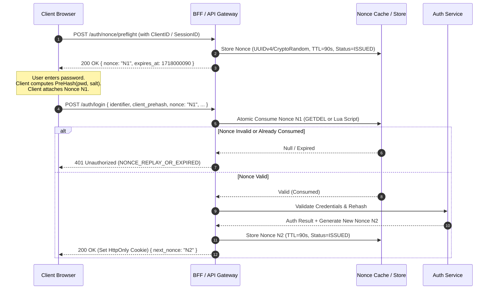
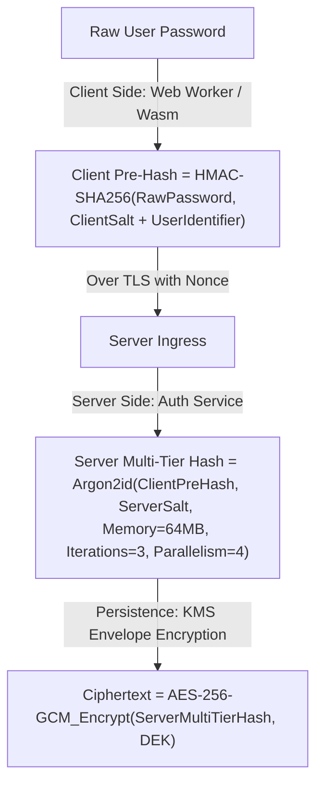
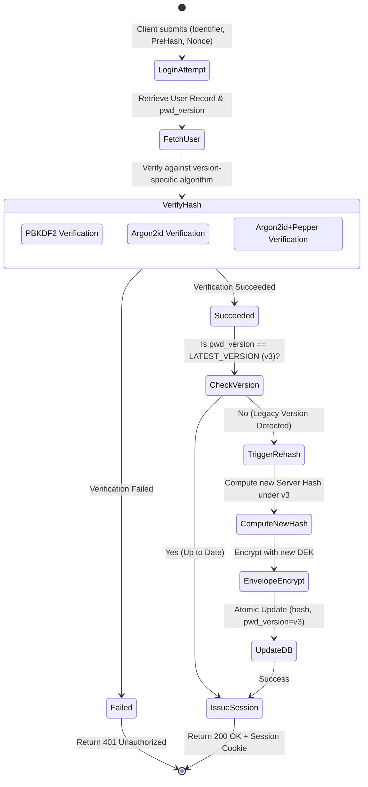

# Zero-Trust Authentication Flow & Password Versioning

This guide specifies the end-to-end authentication protocol, covering cryptographic nonce handshakes, multi-tier salted hashing, and transparent password version upgrades.

---

## 1. Nonce Handshake & Anti-Replay Architecture

In a zero-trust model, even under full TLS transport, any high-security operation (login, password modification, 2FA addition, profile credential update) must be immune to replay attacks through pre-negotiated, single-use cryptographic nonces.

### Nonce Lifecycle Rules:
1. **Scope Specificity**: Nonces can be bound to action scopes (e.g., `scope: "login"`, `scope: "mfa_verify"`).
2. **Atomic Consumption**: Must use atomic operations (e.g., Redis `GETDEL` or database conditional updates) to prevent race condition replay.
3. **Continuous Rotation**: Every successful or failed authenticated response returns a fresh `next_nonce` to maintain the chain for subsequent operations.

---

## 2. Multi-Tier Salted Hashing Pipeline

To prevent plaintext password exposure in client memory snapshots, network hops, and server compromises, password verification is split across multiple cryptographic tiers.

### Advantages:
- **Zero Raw Password on Network**: Even if TLS terminates at an untrusted intermediary or internal proxy, the raw password is never present.
- **Immunity to Database Leaks**: Even if raw DB tables leak, an attacker only gets AES-GCM ciphertext. If DEKs leak, they get Argon2id hashes of client pre-hashes, requiring double brute-force.

---

## 3. Password Versioning & Automatic In-Flight Migration

As cryptographic standards evolve (e.g., from PBKDF2/SHA-256 to Argon2id with increasing memory costs), applications must support multiple password schema versions concurrently without forcing mass password resets.

### Schema Version Registry

| Version | Client Pre-Hash | Server Hash Algorithm | Parameters | Status |
| :--- | :--- | :--- | :--- | :--- |
| `v1` (Legacy) | SHA-256 | PBKDF2-HMAC-SHA256 | Iterations: 100,000 | Deprecated |
| `v2` (Stable) | HMAC-SHA256 | Argon2id | Memory: 64MB, Iter: 3, Parallelism: 4 | Active |
| `v3` (Next-Gen)| HMAC-SHA512 | Argon2id + Pepper (HSM) | Memory: 128MB, Iter: 4, Parallelism: 8 | Target |

### Automated Upgrade State Machine:

### Code Implementation Guidelines:
- The version upgrade must be non-blocking to the user (asynchronous queue or fast inline transaction).
- Version upgrades must log audit events (`AUTH_PASSWORD_VERSION_UPGRADED`) for compliance tracking.
- Client pre-hash versions can be communicated during the nonce preflight phase via headers or preflight metadata (e.g., `X-Auth-Version-Supported: v2,v3`).
